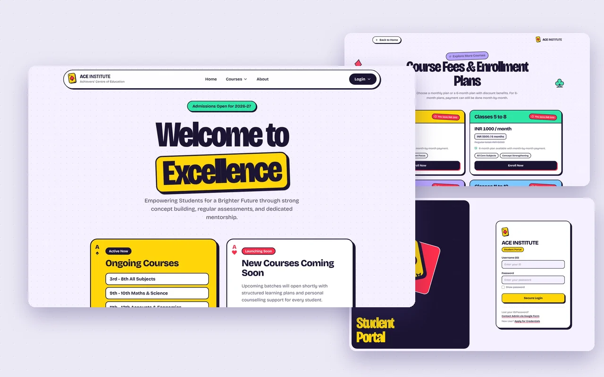

# 🎓 ACE Academy

An institute management system for **ACE Institute (Achievers' Centre of Education)**. Admins, teachers and students each get their own dashboard, and changes show up live.

[](https://achieverscentreofeducation.vercel.app/)


<p align="center">
  
</p>

> Built and delivered as a paid client project. In production on Vercel (frontend) and Render (API), with MongoDB.

## What each role can do

| Admin | Teacher | Student |
|---|---|---|
| Create teacher and student accounts | Mark attendance for their classes | See their attendance and marks |
| View every user and their records | Enter marks per test | Download study materials |
| See login and logout activity logs | Upload study materials and the timetable | See the class timetable |
| Chat in real time | Look up any student's performance | Chat in real time |
| | Export class progress to Excel | Change their password |

Plus a **public website** for admissions, courses and fee plans, and an **installable app** (PWA) so students and teachers can add it to their home screen without an app store.

## Architecture

```
 Browser / installed PWA
        │
        ▼
 React 19 + Vite  ──────────────►  Vercel
        │  REST (fetch)   ▲
        │                 │ Socket.IO (chat, live updates)
        ▼                 │
 Express 5 API + Socket.IO server ──►  Render
        │
        ▼
 MongoDB (Mongoose models: User, Course, Attendance, Mark,
                Progress, Timetable, Note, Message, Log)
```

## API overview

| Area | Routes |
|---|---|
| Auth | `POST /login`, `/logout`, `/register`, `/change-password` |
| Admin | create user, list users, login logs |
| Records | students, teachers, attendance, marks, stats, profiles |
| Learning | notes upload and download, timetable, class progress |
| Chat | message history per room; live messages over Socket.IO |
| Public | courses and teachers for the public site |

## Run it locally

**Requirements:** Node.js 20+, a MongoDB connection string.

```bash
git clone https://github.com/rohitpawalia28/ACE-Academy.git
cd ACE-Academy

# API
cd backend
npm install
# create backend/.env with:
#   MONGODB_URI=mongodb+srv://...
#   CLIENT_URL=http://localhost:5173
node server.js            # http://localhost:5000

# Web app (in a second terminal)
cd frontend
npm install
npm run dev               # http://localhost:5173
```

> The web app currently calls the hosted API. To use your local API, point the API base URL in `frontend/src` to `http://localhost:5000`.

## Project structure

```
├── backend/
│   ├── server.js        # Express app, CORS, Socket.IO, MongoDB connection
│   ├── models/          # Mongoose schemas
│   └── routes/          # auth, admin, records, notes, timetable, progress, chat, public
└── frontend/
    ├── src/pages/       # Home, Courses, Login, Admin/Teacher/Student dashboards
    ├── src/components/  # Class progress, admin logs, logo
    └── vite.config.js   # PWA setup
```

## Team

**Rohit Kumar** ([@rohitpawalia28](https://github.com/rohitpawalia28)) · Nakul Thombare · Sai Vatsav

VIT Vellore, School of Computer Science Engineering and Information Systems.
